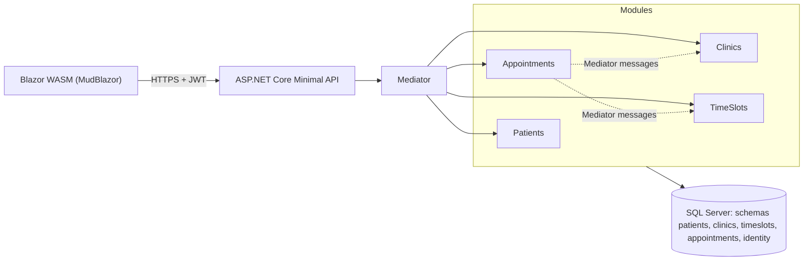
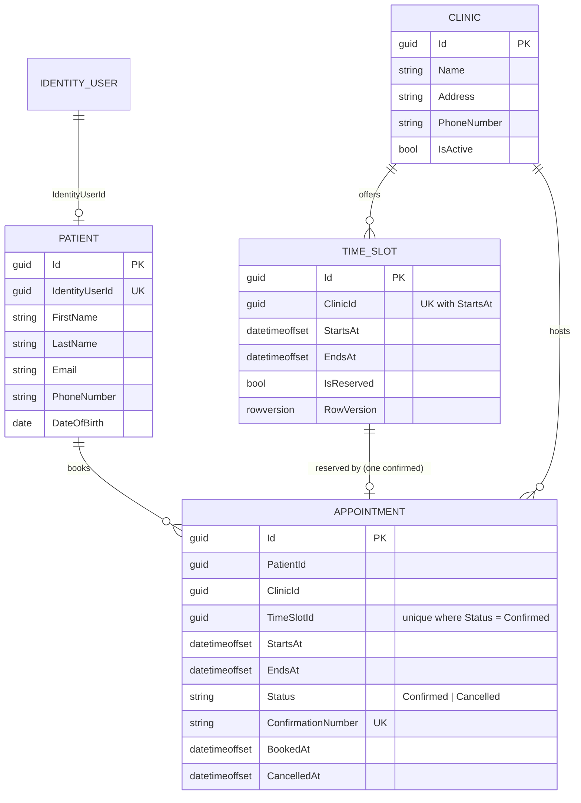
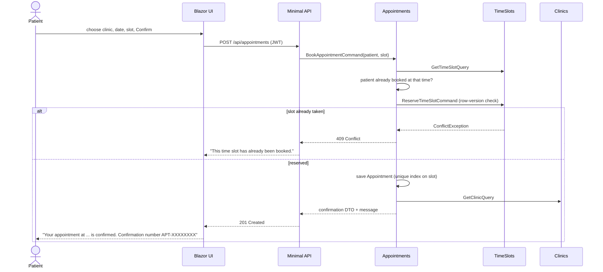

# Architecture

## Style: modular monolith

One deployable API hosts four business modules. Each module has its own Domain, Application and Persistence
project and its own `DbContext`/database schema. Modules never reference each other's Domain or Persistence;
they talk through the other module's **Application layer** by sending Mediator commands/queries
(e.g. Appointments sends `ReserveTimeSlotCommand` to TimeSlots). Any module can later be extracted into a service
by replacing those messages with HTTP/queue calls.

## Dependencies inside a module

`Domain  <-  Application  <-  Persistence`, composed by the API host. Shared building blocks:

* `ClinicBookingSystem.SharedKernel` – entity base type, `DomainException`, `NotFoundException`, `ConflictException`
* `ClinicBookingSystem.Contracts` – DTOs, request models and FluentValidation validators shared by API and Blazor

NuGet versions are centralised in `Directory.Packages.props`; layer-wide package references
(Mediator, FluentValidation, EF Core, test stack) and project references between layers live in `Directory.Build.props`.

## Data model

Cross-module references are plain Guids (no foreign keys across schemas) to keep modules independently deployable.

## Booking sequence

If saving the appointment fails after the slot was reserved, the handler releases the slot (compensation), because
the two modules use separate `DbContext`s and therefore separate transactions.

## Double-booking defence (three layers)

1. Domain: `TimeSlot.Reserve` throws when the slot is already reserved.
2. Concurrency: `TimeSlot.RowVersion` makes simultaneous reservations fail with a concurrency conflict (HTTP 409).
3. Database: unique filtered index on `Appointments.TimeSlotId` where `Status = 'Confirmed'`.

## Error handling

`ApiExceptionHandler` maps `ValidationException` -> 400, `NotFoundException` -> 404, `ConflictException` -> 409,
`DomainException` -> 422 as RFC 7807 problem details. A Mediator `ValidationBehavior` runs FluentValidation validators
before every handler.

## Testing strategy

| Level | Project | Tools |
|---|---|---|
| Unit (domain + handlers) | `ClinicBookingSystem.UnitTests` | xUnit v3, Shouldly, NSubstitute |
| End-to-end (browser) | `ClinicBookingSystem.E2ETests` | Playwright, Shouldly |
